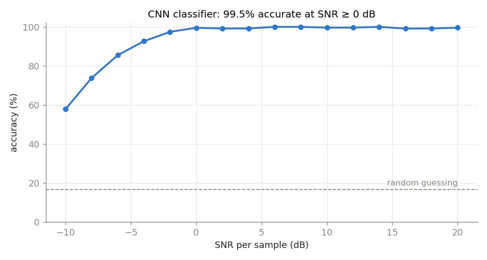
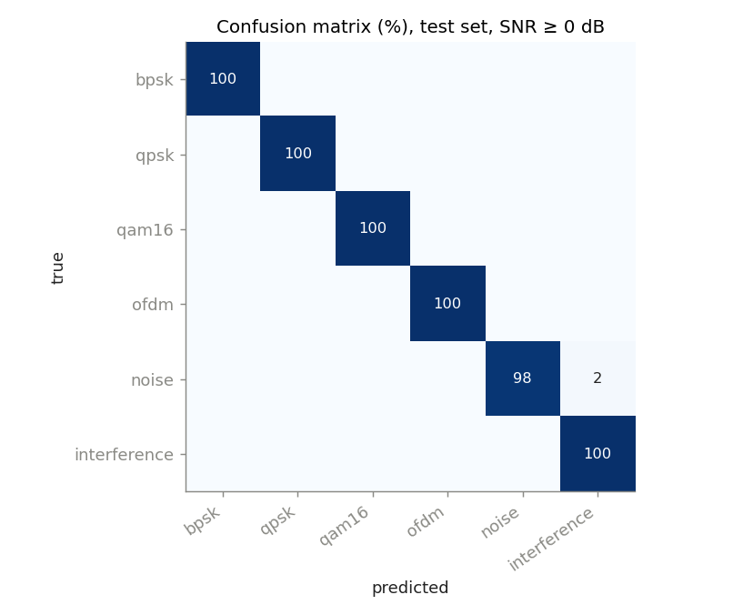
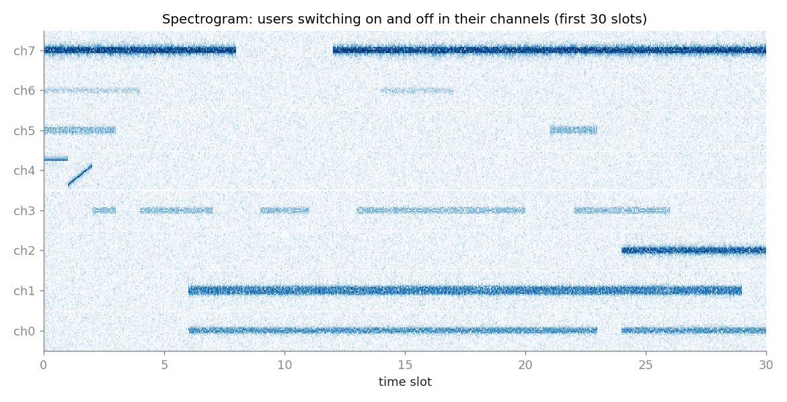
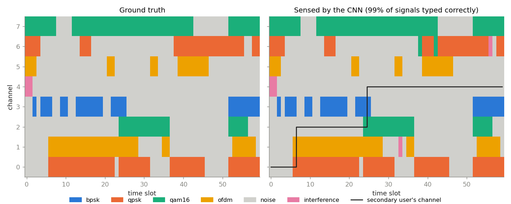
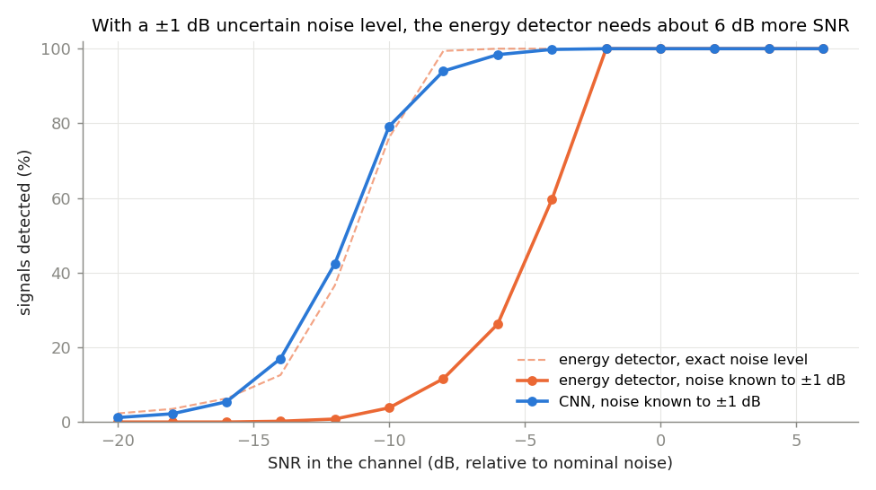
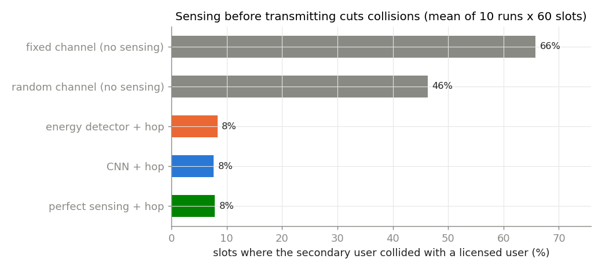
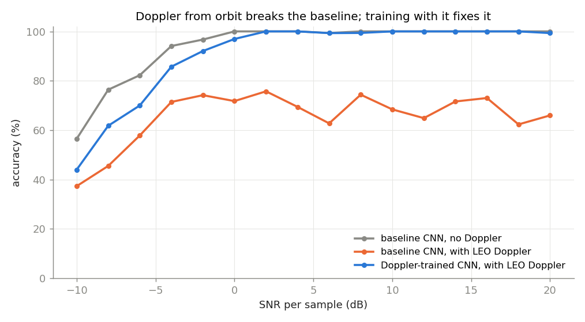
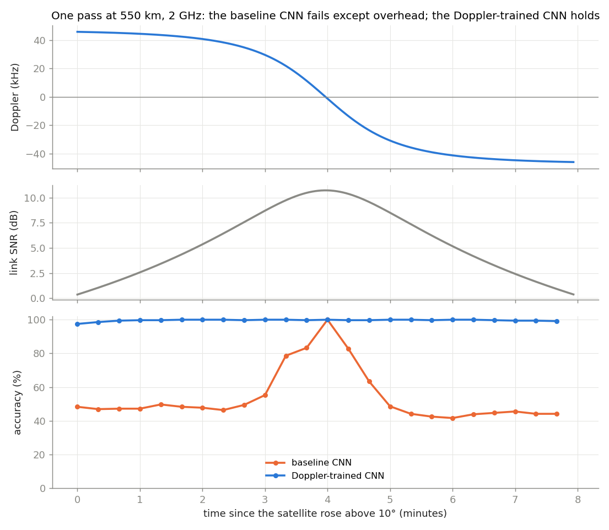
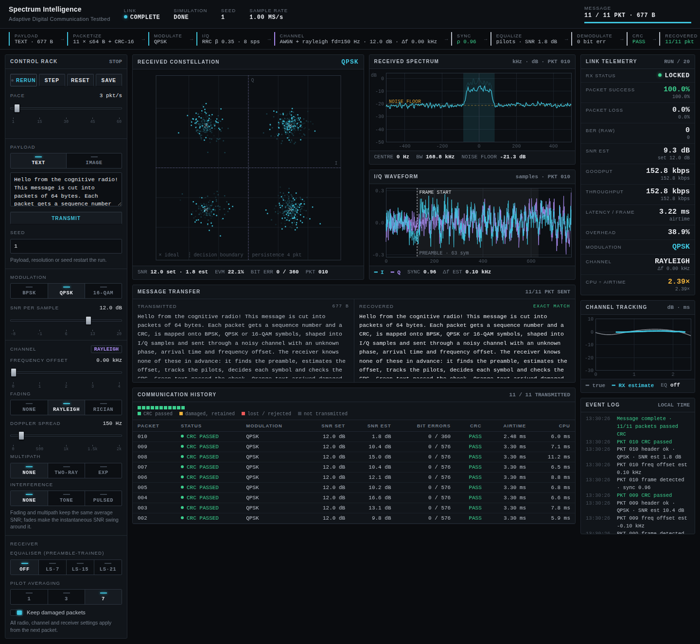

# AI-Based Cognitive Radio Spectrum Intelligence

A simulated cognitive radio that **senses an 8-channel band, recognises what is in
each channel with a CNN, and picks a free channel to transmit on**, then tests the
same system **from a LEO satellite**, where orbital Doppler breaks a normally trained
classifier and Doppler-aware training fixes it.

```
I/Q samples → spectrum & spectrogram → channelizer → detection → CNN classifier → occupancy map → channel choice
                                                                              ↘ LEO extension: Doppler + path loss
```

## Results at a glance

| Experiment | Result |
|---|---|
| Classify 6 signal types (BPSK, QPSK, 16-QAM, OFDM, noise, interference) from raw I/Q | **99.5%** accuracy at SNR ≥ 0 dB, 94.4% over −10 to +20 dB (unseen test set) |
| Detect a signal in a channel, noise level known exactly | Energy detector and CNN equal: 90% detection at −8 dB SNR |
| Same, with the noise level uncertain by ±1 dB (realistic) | CNN still detects at −8 dB; energy detector needs −2 dB (**6 dB worse**) or raises 33% false alarms |
| Full 8-channel system, 10 runs × 60 slots | CNN names the signal in **98.8%** of busy channel-slots; sensing cuts collisions from 46–66% to **≈ 8%** |
| Same CNN on a satellite at 550 km, 2 GHz (Doppler up to ±46 kHz) | Drops to **69%** at SNR ≥ 0 dB |
| CNN trained with Doppler augmentation | Back to **99.5%** with Doppler, stays above 97% for the whole 8-minute pass |

<table>
<tr><td></td><td></td></tr>
<tr><td></td><td></td></tr>
<tr><td></td><td></td></tr>
<tr><td></td><td></td></tr>
</table>

All numbers are in [`results/metrics.json`](results/metrics.json).

## End-to-end communication link (upgrade in progress)

The project is being extended from spectrum *analysis* into a full communication system:
information → bits → packets → modulation → I/Q → channel → receiver → information.

**Phase 1 (done): text over an AWGN link.** The receiver knows nothing in advance except the
preamble and pilots. It finds the frame, the symbol timing, the frequency offset, the phase and
the SNR from the received samples alone.

| Measured (100 frames per point, AWGN, random phase and arrival time) | BPSK | QPSK | 16-QAM |
|---|---|---|---|
| Loss vs textbook theory at BER 10⁻³ | 0.2 dB | 0.3 dB | 0.6 dB |
| SNR per sample for ≥ 90% of 64-byte packets to pass CRC | −1 dB | 3 dB | 10 dB |

- Frame: 63-symbol m-sequence preamble, 32-bit BPSK PHY header (modulation, length, CRC-16),
  payload, one pilot every 16 symbols. Packets: sequence number, length, CRC-16; losses are reported, never hidden.
- Receiver: matched filter → segmented preamble correlation (timing + frame sync, robust to frequency offset;
  threshold set from measured noise statistics) → multi-lag frequency estimate refined by the pilot phase slope →
  pilot-based gain/phase tracking → demapping → CRC. Optional coarse frequency search handles LEO-scale Doppler.

**Phase 2 (done): images.** Images are sent as raw 8-bit pixels (a compressed file breaks with one bit error).
Same channel, two receiver policies: *strict* drops packets that fail the CRC; *error-tolerant* keeps a damaged
packet if its header is self-consistent (CRC-valid packets always take priority).

| Measured (64×64 RGB, 193 packets, 2 trials per point) | BPSK | QPSK | 16-QAM |
|---|---|---|---|
| SNR for image PSNR ≥ 30 dB, error-tolerant | 0 dB | 2 dB | 10 dB |
| SNR for image PSNR ≥ 30 dB, strict | 2 dB | 4 dB | 12 dB |
| Mean PSNR gain of error-tolerant mode where packets were lost | +10.5 dB | +9.4 dB | +5.7 dB |
| SNR where the compressed PNG always decodes | 2 dB | 6 dB | 12 dB |

**Phase 3 (done): link metrics.** One scorecard for every transmission: frame detection, header success,
packet success/error rate, BER, SER, PHY rate, throughput, goodput (useful bits that arrived intact),
spectral efficiency, overhead and airtime latency (default 1 MS/s → 125 kBd, 168.75 kHz occupied bandwidth).

| Measured (64-byte packets, 24 packets × 2 trials per point) | BPSK | QPSK | 16-QAM |
|---|---|---|---|
| Peak goodput | 89 kbps | 155 kbps | 247 kbps |
| Overhead (preamble + headers + pilots + CRC) | 29% | 38% | 51% |
| Airtime per frame | 5.7 ms | 3.3 ms | 2.1 ms |
| SNR for packet error rate < 10% | 0 dB | 3 dB | 10 dB |
| SNR range where it gives the highest goodput | below 1 dB | 1–8 dB | 9 dB and above |

- The best modulation changes with SNR (switch points 1 dB and 9 dB): the basis for adaptive modulation.
- Packet size is a trade-off: small packets survive noise, large packets waste less on overhead
  (16 B: 69% overhead, 1024 B: 9%). Best goodput: 16 B at ≤ 0 dB, 64 B at 1 dB, 256 B at 2–4 dB, 1024 B at ≥ 5 dB (QPSK).
- The original CNN, never trained on these frames, recognises the link's own modulation from a 1024-sample
  payload window: 100% / 99.2% / 99.7% (BPSK / QPSK / 16-QAM) at SNR ≥ 0 dB.

**Phase 4 (done): live dashboard.** A local web page (Python standard library only, no internet needed)
styled as a dark RF test-bench shows the link working packet by packet: the TX → channel → RX pipeline with live
values at each stage, the received constellation (with decision boundaries and EVM), spectrum (with occupied band
and noise floor), I/Q waveform (with the detected frame start), link telemetry, a packet-by-packet event log,
transmitted vs recovered message, and the packet history. Modulation, SNR, frequency offset and error-tolerant
mode can be changed while it runs; "Save run" writes a new results folder.



- The real-time engine runs the same per-packet code as the experiments; for the same seed it gives
  bit-identical packets and received bytes (checked by tests and by the experiment).
- Profiling showed ~60% of the time per packet went into recomputing the same pulse-shaping filter.
  Computing it once changed no output (regression check: 0 difference) and made each packet 2.4× faster
  (2.3–3.0× across runs on this machine).

| Measured (median of 40 packets, 1 MS/s, 2-core cloud CPU; rerun on yours) | BPSK | QPSK | 16-QAM |
|---|---|---|---|
| CPU time ÷ airtime, 64-byte packets, before → after | 1.7 → 0.99 | 2.5 → 1.03 | 3.7 → 1.45 |
| CPU time ÷ airtime after, 16 / 64 / 256 / 1024 B | 1.23 / 0.99 / 0.75 / 0.92 | 1.48 / 1.03 / 0.78 / 0.87 | 1.96 / 1.45 / 1.20 / 1.05 |

Below 1 the link is processed faster than it is transmitted. The remaining time is mostly frame sync
(seven full-length correlations per burst).

Found with the dashboard: in error-tolerant mode a bit error in a packet's *sequence number* files the data
under the wrong slot (seed 1, QPSK, 1.5 dB: packet 1 is read as packet 9, so slot 1 stays empty). The MAC header
is only protected by the packet CRC, which tolerant mode ignores; protecting the header separately is a
candidate for the error-correction phase. The dashboard is a single-user local tool, not a multi-user web app.

**Phase 5 (done): dynamic channel.** Besides noise, the channel can now fade (Rayleigh, Rician with a line of sight,
block or with Doppler), add echoes (two-ray or exponential delay spread) and add interference (a tone or a pulsed
noise jammer). The receiver gained an optional preamble-trained least-squares equaliser and an adjustable pilot
averaging window. Everything is switchable live in the dashboard, which also shows the true channel against the
receiver's estimate. With every impairment off the link is bit-identical to before.

| Measured (QPSK, 64-byte packets, 80 packets per point, same seeds for every receiver) | Result |
|---|---|
| SNR for 99% of packets: AWGN / Rician K=10 dB / Rician K=3 dB / Rayleigh | 5 / 8 / 14 / 19 dB |
| Rayleigh vs the outage law exp(−10^((T−SNR)/10)), T = AWGN 50% point | within 0.11 at every SNR |
| Two-ray echo (−3 dB) at 15 dB, longest echo with ≥ 90% success: none / LS 7 / LS 15 / LS 21 taps | under 2 µs / 12 µs / 24 µs / 24 µs (80% at 32 µs) |
| Cost of the equaliser on a clean channel (AWGN 1 dB): none / LS 7 / LS 15 / LS 21 | 54% / 36% / 20% / 6% of packets pass |
| Rayleigh at 25 dB, 1 kHz Doppler: averaging 7 / 3 / 1 pilots | 3% / 38% / 71% pass (but at AWGN 1 dB: 56% / 45% / 16%) |
| SIR for 90% at SNR 15 dB: tone / pulsed (10% duty) jammer | 5 dB / 10.5 dB |
| Pulsed jammer at SIR 10 dB: 16 / 64 / 256-byte packets | 96% / 80% / 55% pass |
| Echo that also fades (8 µs, LS 15): 64-byte packets at 0 / 50 / 200 Hz Doppler | 97% / 36% / 1% |

- **Receiver bug found by fading and fixed.** Frame sync took the position with the largest *raw* correlation.
  When the preamble arrived in a fade and the rest of the frame was 13 dB stronger, random correlation with the
  data beat the true preamble and the frame was missed even at 25 dB. Sync now also checks the best *normalised*
  position when the raw peak fails the threshold. In AWGN nothing changes from −10 dB upward (2 extra detections in
  300 frames at −12 and −14 dB, whose headers still fail); with Rayleigh fading at 50 Hz Doppler, success rose from
  88% to 98.5%. A test reproduces the case.
- **Trade-offs, not free wins.** Longer equalisers reach longer echoes but cost noise on clean channels; averaging
  fewer pilots follows fast fading but costs noise on still channels. Choosing them from the measured channel is
  the job of the adaptive phase.
- **Known limitation.** The equaliser is trained once per frame on the preamble, so an echo that changes during
  the frame defeats it (last row). Shorter packets help; real systems spread pilots through the whole frame
  (OFDM pilots in LTE/5G) or adapt the equaliser continuously (LMS/RLS).

**Phase 6 (done): adaptive modulation.** The transmitter now chooses each packet's modulation from what the
receiver reported about the previous packet (its SNR estimate and ACK/NACK), so its information is always one
packet old, as in a real link. Decisions use a calibration table of packet error rate vs SNR measured with this
very receiver (`scripts/calibrate_link_table.py`: 10% errors at −1.1 / 2.4 / 9.6 dB for BPSK / QPSK / 16-QAM).
Three policies: **threshold** (fastest modulation within a 10% error target), **OLLA** (the same plus an
outer loop that learns a correction from ACK/NACK, as LTE does) and **goodput** (highest expected delivered data).
In the dashboard: Modulation → AUTO, plus an SNR swing to imitate a moving user.

| Measured (64-byte packets; every policy sees the same channel draws) | Result |
|---|---|
| Steady SNR −2 to 20 dB: goodput policy vs the best fixed modulation at each SNR | 98% on average, never below 96% |
| Moving user (SNR 8 ± 10 dB, 600 packets): goodput, kbps | BPSK 84 · QPSK 115 · 16-QAM 126 · threshold 138 · OLLA 130 · **goodput 142** (genie 137) |
| Same run: packet error rate | 16-QAM 49% · goodput policy 8% · OLLA 10.5% |
| Rayleigh fading, mean 10 dB, slow (Doppler × packet interval = 0.025) | best fixed 151 kbps → goodput policy 170 kbps (+13%) |
| Same, fast (Doppler × interval ≥ 0.25: channel nearly new every packet) | goodput policy 119–123 kbps vs fixed QPSK 132–139: stale feedback is worse than none (genie: 145–154) |
| Packet error rate across all fading speeds | OLLA 9–12% (target 10%); threshold rises to 27% |

- **A 10% error target is not the same as maximum throughput.** At 2 dB QPSK fails 14% of packets yet delivers
  140 kbps against BPSK's 89. LTE aims for 10% because it retransmits; without retransmission the goodput policy wins.
- **Adaptation only helps when feedback is still true when it is used.** When the channel decorrelates between
  packets (fast fading), choosing from the last report adds risk without information; a fixed robust choice, or
  deciding from the average SNR, would be better. The genie shows what timely feedback would be worth.

**Phase 7 (done): smarter channel selection.** The original cognitive layer hopped to the free channel idle
the longest and only counted collisions. Now the link actually lives in the 8-channel band (`selection.py`):
every slot a policy picks a channel *from the past only*, the packet goes through the real PHY at that
channel's SNR (each channel is a different link for us: base SNR + offset of −8 to +8 dB), and if the licensed
user is on, its signal is added as interference at its own power (so a collision may or may not destroy our
packet). Sensing uses the CNN's measured detection / false-alarm rates (100% / 1.48%). Every policy sees the same
licensed users and sensing errors. Policies: **random**, **hop** (the original rule, same decisions, tested),
**predict** (learns each channel's on/off statistics and picks the one most likely free next slot),
**quality** (also learns our SNR on each channel and picks the highest *expected goodput* =
P(free next) × goodput at that SNR, with a hop margin) and **oracle** (quality with the true statistics).
In the dashboard: Spectrum band → on, then pick the policy, sensing quality and harm weight.

| Measured (`exp_channel_selection.py`, base SNR 6 dB, CNN sensing, 3 seeds × 1400 slots) | Collisions | Our goodput |
|---|---|---|
| random (no sensing) | 45.4% | 71 kbps |
| hop (original) | 8.0% | 112 kbps |
| predict (learns on/off) | **6.3%** | 90 kbps |
| quality (learns on/off + our link) | 8.4% | **214 kbps** |
| oracle (true statistics, same rule) | 8.7% | 210 kbps |

| Other parts (seed 8) | Result |
|---|---|
| Goodput, hop → quality, at base SNR 0 / 6 / 12 dB | 56 → 141 (2.5×) · 109 → 211 · 174 → 225 kbps: the gain is largest when the link is weak |
| Hop margin 0 → 1.0 (quality) | hops per 100 slots 15.4 → 8.9; with a 5 ms cost per hop the best goodput moves from margin 0 (168 kbps) to 1.0 (182) |
| Sensing perfect / CNN / degraded (Pd 0.9, Pfa 0.1) / poor (0.7, 0.25): collisions of hop · predict · quality | 8.6·6.1·8.4% / 8.3·6.3·7.7% / 9.0·8.4·12.7% / 19.9·13.1·**38.0%** |
| Harm weight 0 → 1 (quality, poor sensing) | collisions 38.0% → 16.8%, goodput 243 → 203 kbps (still about 2× hop) |
| Harm weight 0 → 4 (quality, CNN sensing) | collisions 7.7% → 7.1%, goodput 219 → 208 kbps: little to gain when sensing is good |

- **Two goals, not one.** Learning the on/off statistics (predict) gives the fewest collisions; learning our own
  link (quality) nearly doubles goodput but does *not* reduce collisions: it matches the original rule (8.4%
  vs 8.0%) and collides more than predict. Hypothesis checks: H1 (predict collides less) held; H2 ("more goodput
  at no extra harm") held only against the original rule; H3 held in a changed form: the best hop margin grows with
  the cost of a hop (the largest margin tested won at 5 ms); H4 ("ranking survives sensing errors") failed for
  collisions under poor sensing, as the next point shows.
- **Capture effect.** A collision is not always a lost packet: when our signal is much stronger than the
  licensed user's, our packet survives. With poor sensing the goodput-seeking policy exploits this and collides
  in 38% of slots while its own goodput *rises* — good for us, bad for the licensed user. The **harm weight**
  (subtracting the predicted chance of a collision from each channel's score) was added *after* seeing this, and
  trades ~16% of our goodput for less than half the collisions.
- **"Oracle" is not an upper bound here.** It knows the true statistics but uses the same one-step greedy rule,
  so quality matches it once it has learned (within the run-to-run spread). A true bound would plan ahead.
- **Limitations.** Licensed users follow simple two-state Markov chains with fixed rates; our per-channel SNR is
  constant (no fading between slots); one secondary user only (no competition); collisions are counted per slot,
  not by how much they hurt the licensed user's own link.

**Phase 8 (done): error correction (FEC).** Packets can now carry a convolutional code (`fec.py`):
constraint length 7, generators 133/171 (the Wi-Fi and DVB-S code), rate 1/2, punctured to 2/3 and 3/4,
a pseudo-random interleaver, and a Viterbi decoder fed with **soft** decisions (how sure the receiver is
about each bit) or **hard** 0/1 decisions. The PHY header says which code follows (uncoded frames are
bit-for-bit unchanged). Telemetry now shows the raw bit error rate on air and the rate after decoding.
In the dashboard: Error correction → RATE ½ / ⅔ / ¾, decoder SOFT / SOFT·FIXED / HARD, interleaver on/off.

| Measured (`exp_fec.py`, 64-byte packets, 120–150 per point) | Result |
|---|---|
| SNR for 10% packet errors, uncoded → rate 1/2 soft: BPSK / QPSK / 16-QAM | −0.8 → −3.0 · +2.4 → −2.9 · +9.6 → −0.2 dB (gain **2.2 / 5.3 / 9.8 dB**) |
| Same, counting only packets whose header arrived (what the code itself does) | gain ≥ 5.2 / 8.0 / 9.8 dB |
| Soft vs hard decoding (payload only), QPSK / 16-QAM | soft better by 1.6 / 2.8 dB |
| Best goodput at −4 / 0 / 5 / 12 dB: uncoded → coding allowed | 4 → 85 (QPSK ⅔) · 88 → 141 (16-QAM ½) · 155 → 196 (16-QAM ¾) · 247 uncoded 16-QAM wins from 9 dB |
| Fast fading inside a packet (Doppler 500 Hz), mean SNR for 10% payload errors | uncoded: never (up to 24 dB) · no interleaver 13.8 · hard 4.4 · soft ≤ 0 dB |
| Long jammer bursts (500 µs every 5 ms), SIR for 10% payload errors | uncoded: never · no interleaver 3.1 · hard −5.8 · soft with one noise level −1.9 · soft with local noise ≤ −10 dB |
| Processing time per 64-byte packet (Python Viterbi) | 8–13 ms with FEC vs 3–4 ms without (slower than real time for 16-QAM) |

- **The uncoded header is now the weakest part.** Below about −3 dB, coded packets whose header arrives are
  decoded with no errors; they fail because the 32-bit BPSK header (and frame detection) fail first. That is why
  BPSK gains only 2.2 dB overall but at least 5.2 dB on the payload. Wi-Fi codes its header field for this reason;
  coding ours is the obvious next step.
- **Soft decoding was fooled by interference bursts (found by the first run, then fixed).** The LLRs used one
  noise level measured on the preamble, so symbols hit by a jammer burst looked like very confident wrong bits:
  soft decoding did *worse* than hard (96% vs 33% payload loss at SIR −10 dB). The receiver now also measures
  the noise around each symbol (distance to the nearest constellation point, averaged over 9 symbols) and uses the
  larger value. AWGN results are unchanged; under bursts soft is now the best. The old behaviour stays selectable
  (`soft_fixed`) and is plotted beside it.
- **The interleaver is what makes coding work against bursts.** Without it, fast fading needs 13.8 dB instead of
  ≤ 0 dB. With slow fading (one fade per packet) there is nothing to spread and it makes no difference, as expected.
  Even short jammer bursts (50 µs every 500 µs) need it: −2.2 dB SIR without, −7.7 dB with (soft).
- **Coding is not free.** Rate 1/2 roughly halves the peak rate (16-QAM: 247 → 149 kbps); above about 9 dB
  uncoded 16-QAM is best. The best scheme moves BPSK ½ → QPSK ½ … ¾ → 16-QAM ½ … ¾ → uncoded as SNR rises.
  Choosing the code automatically (adaptive modulation *and* coding, as in LTE) is the natural extension of Phase 6.

```bash
python scripts/dashboard.py                                                    # opens http://127.0.0.1:8765
python scripts/dashboard.py --source image --snr 3                            # the sample photo
python scripts/exp_realtime.py                                                 # speed before/after (~20 s)
python scripts/exp_channel.py                                                  # fading, multipath, jamming (~75 s)
python scripts/calibrate_link_table.py                                         # PER-vs-SNR table for adaptation (~90 s)
python scripts/exp_adaptation.py                                               # adaptive vs fixed modulation (~3 min)
python scripts/exp_channel_selection.py                                        # which channel to use (~4.5 min)
python scripts/exp_fec.py                                                      # error correction (~4.5 min, 2 cores)
python scripts/exp_link_metrics.py                                             # scorecard sweep (~1.5 min)
python scripts/demo_image_link.py --snr 2                                      # original vs strict vs tolerant vs PNG
python scripts/exp_image_link.py                                               # PSNR/SSIM vs SNR sweep (~3 min)
python scripts/demo_text_link.py --text "Hello satellite" --mod qpsk --snr 3   # every stage, printed + figure
python scripts/exp_link_ber.py                                                 # BER/SER/packet success vs SNR
python scripts/check_regression.py                                             # original results unchanged?
```
New experiment runs are saved under `results/experiments/<name>/<time>-seed<N>/` and are never overwritten.
The original validated numbers are frozen in `results/validated/metrics_v1.json`.

## How it works

1. **Signals** (`signals.py`): BPSK, QPSK and 16-QAM with root-raised-cosine pulse shaping
   (8 samples/symbol, β = 0.35); OFDM with 20 QPSK subcarriers, 128-point FFT and cyclic prefix;
   receiver noise; CW-tone or chirp interference. Random carrier phase and timing, AWGN at a chosen SNR.
2. **Band** (`spectrum.py`): eight channels side by side at 8× the channel rate. A channelizer
   (shift → root-raised-cosine low-pass → decimate) returns each channel in exactly the
   classifier's input format; its filter keeps channelised noise white.
   The noise floor is estimated from the median of the spectrum.
3. **Detection** (`detector.py`): energy detector with a Neyman–Pearson threshold for a
   1% false-alarm rate, compared with the CNN ("occupied" = top class is not noise).
4. **Classification** (`classifier.py`): 1-D CNN on the 2 × 1024 I/Q array
   (4 conv blocks, global average pooling, 110k parameters), trained on 15,000 examples
   from −10 to +20 dB, tested on a separate seed.
5. **Cognitive layer** (`occupancy.py`): licensed users switch on/off as Markov chains;
   the secondary user senses in slot *t* and transmits in slot *t + 1*, staying put while
   its channel is free and otherwise hopping to the free channel idle the longest.
6. **LEO** (`leo.py`): overhead pass at 550 km (7.59 km/s, ~8 min above 10°), Doppler
   f_D = −f_c·ṙ/c, free-space path loss 153–164 dB, link budget giving 0–11 dB SNR in 1 MHz.

## Project layout
```
spectrum_intel/   dsp, signals, dataset, spectrum, detector, classifier, occupancy, leo, plots
                  payload, coding, packet, modulation, transmitter, channel, receiver, link,
                  metrics, experiments, engine, dashboard (+ web/dashboard.html), adaptation (+ link_table.json), selection, fec   (communication link)
scripts/          train_classifier, evaluate_detection, run_spectrum_demo, run_leo_experiment,
                  preview_signals, run_all, demo_text_link, exp_link_ber, check_regression,
                  demo_image_link, exp_image_link, exp_link_metrics,
                  dashboard, exp_realtime, exp_channel, calibrate_link_table, exp_adaptation, exp_channel_selection, exp_fec
models/           cnn_baseline.pt, cnn_doppler.pt  (trained weights, 455 KB each)
docs/             dashboard screenshot
results/          figures + metrics.json (validated), validated/ (frozen copy), experiments/ (new runs)
tests/            195 automated checks
```

## Setup and run (macOS)
```bash
python3 -m venv .venv
source .venv/bin/activate
pip install -r requirements.txt

python -m pytest                    # 195 checks
python scripts/run_all.py           # every experiment with the saved models (~3 min)
python scripts/run_all.py --retrain # retrain both CNNs too (~20 min CPU, faster on Apple GPU)
```

## Limitations and next steps
Simulated signals only; channel effects limited to AWGN, phase, timing and Doppler;
fixed 8-channel grid; simplified orbit (directly overhead, no Earth rotation).
Next: real captures with an RTL-SDR or the RadioML 2018 dataset, multipath fading,
open-set "unknown signal" detection, spectrogram object detection for signals of any
width, and SGP4 orbits with real satellite elements.
